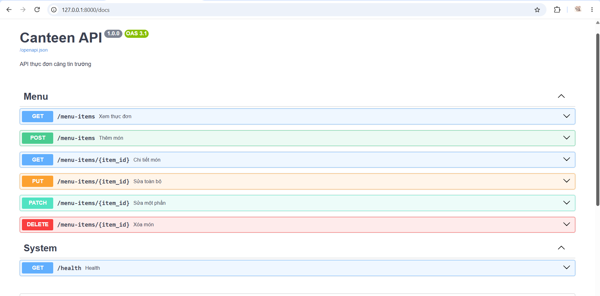
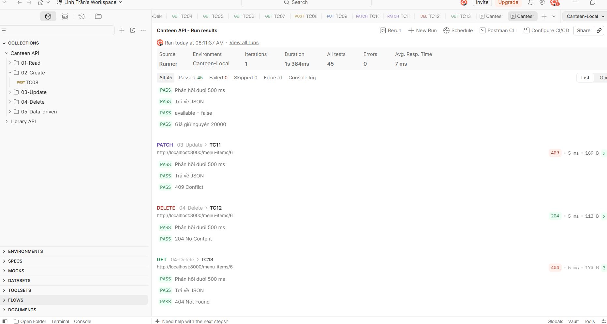
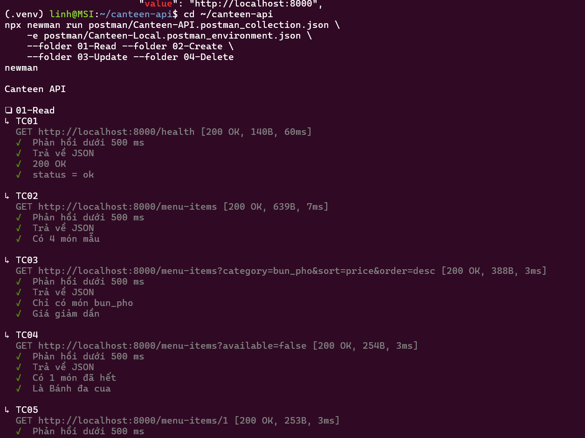
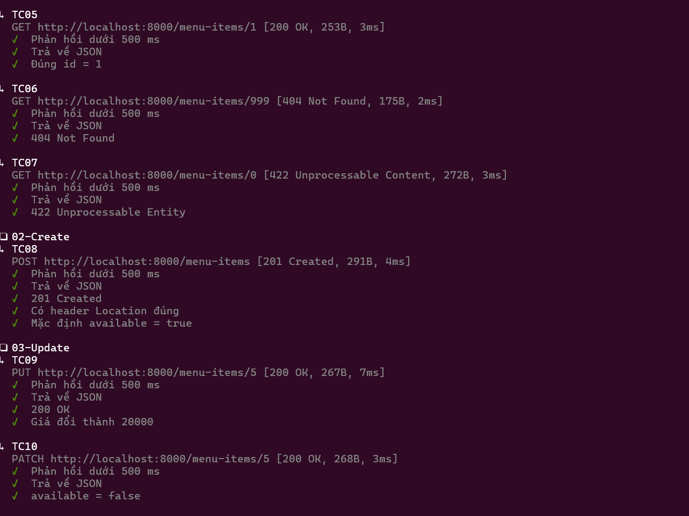

# Canteen API

API thực đơn căng tin trường, viết bằng FastAPI. Bài thực hành học phần Lập trình mã nguồn mở (POS02024).

## Cấu trúc

- `app/schemas.py`: định dạng dữ liệu vào/ra (Pydantic)
- `app/repository.py`: lưu trữ trong bộ nhớ
- `app/routers/menu.py`: 6 endpoint CRUD và quy tắc nghiệp vụ
- `app/main.py`: khởi tạo ứng dụng
- `docs/design.md`: thiết kế API
- `postman/`: collection, environment, `negative.csv`

## Cách chạy

```bash
python3 -m venv .venv && source .venv/bin/activate
pip install -r requirements.txt
python -m uvicorn app.main:app --reload
```

Mở http://127.0.0.1:8000/docs để xem Swagger.

## Kiểm thử bằng Newman

Khởi động lại server trước mỗi lệnh để dữ liệu về 4 món mẫu.

```bash
npx newman run postman/Canteen-API.postman_collection.json \
    -e postman/Canteen-Local.postman_environment.json \
    --folder 01-Read --folder 02-Create \
    --folder 03-Update --folder 04-Delete

npx newman run postman/Canteen-API.postman_collection.json \
    -e postman/Canteen-Local.postman_environment.json \
    --folder 05-Data-driven -d postman/negative.csv
```

## Minh chứng

### Swagger


### Postman Runner


### Newman


### Newman (data-driven)
